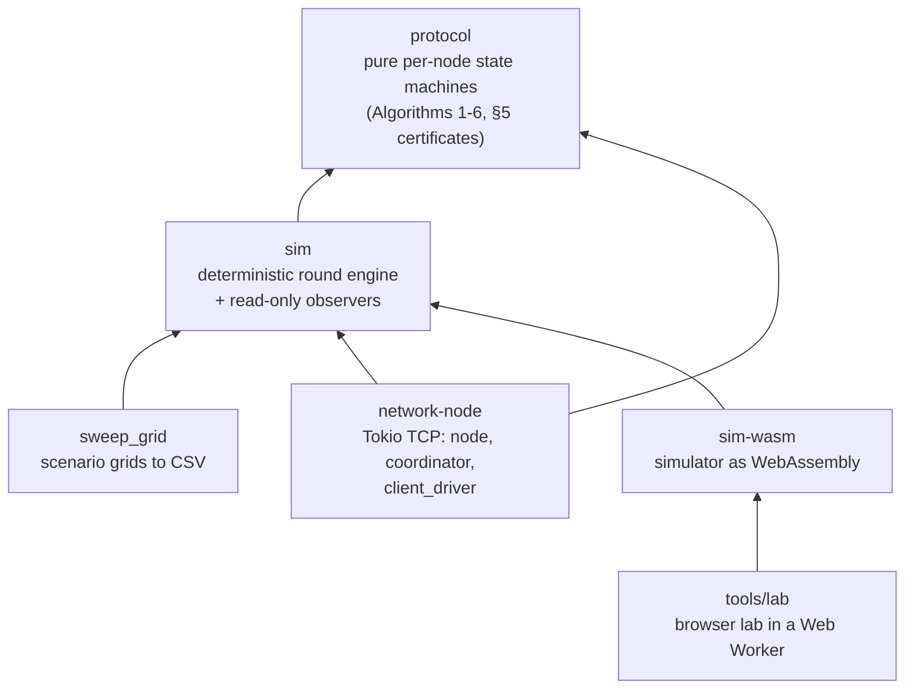

<div align="center">

# Lightweight state machine replication

**Thousands of servers agreeing on one log, with each server talking to only a few random peers per round.**


[](https://jmenzler.github.io/lightweight-smr-blockchain/)


[Architecture](#architecture) · [Run it locally](#run-it-locally)

</div>

A Rust implementation of the protocol from "A Lightweight Approach for State Machine Replication" by Cachin, Dou, Scheideler and Schneider ([arXiv:2509.17771](https://arxiv.org/abs/2509.17771v2)), written for my bachelor thesis.

**[Try the browser lab](https://jmenzler.github.io/lightweight-smr-blockchain/)** to step through the protocol round by round. The simulator runs in your tab as WebAssembly, no setup.

Servers agree on a shared log of client commands with the (6,3)-median rule. Each round, a server asks a few random peers for their logs and keeps the median. The hard parts are showing this holds up at scale and under faults, and keeping the evidence reproducible.

- **Protocol as pure state machines.** The paper's Algorithms 1-6 and §5 certificates, with no I/O, and a map from each paper step to its function.
- **Deterministic simulator.** One seeded RNG stream: same scenario and seed, same bytes out. The Algorithm 1 consensus rule runs up to n = 1,000,000 simulated nodes.
- **Fast and memory-lean at scale.** A multi-round optimisation campaign (interning, copy-on-write shared state, chunked log-prefix sharing, sorted-array indexes) made the full SMR simulator 81x faster and 33x leaner than the pre-campaign code on the same recovery scenario, with identical outputs; 10,000-node full-protocol runs now fit on one machine. Peak memory at n = 4,096 fell 21x (1,253 to 58 MiB, allocator-measured).
- **Beyond the paper's fault bound.** Agreement survives blocking of 14% of nodes per round when the blocked set is re-drawn each round, above the 10% the paper proves; against the paper's own one-round-late adaptive attacker the 10% bound holds (12.4% at the lowest useful fraction tested).
- **Simulator validated against real TCP.** At 1,000 nodes, the simulator's results match the TCP node run under Shadow network emulation (same metrics in every cell, distribution distance within the pre-registered 0.2).
- **Read-only observers.** Safety, commit order and metrics are measured without touching the RNG or the nodes, and a regression test enforces that.
- **Real TCP node.** The same rules over Tokio sockets with a round coordinator and a retrying client driver.
- **Browser lab.** The simulator compiled to WebAssembly in a Web Worker, deployed by GitHub Actions.

> [!NOTE]
> The protocol is the paper's; implementation, experiments and analysis are mine. Thesis data, plots and the emulation setup for the TCP node are not part of this repo. The 1,000,000-node figure covers Algorithm 1 consensus only, not the full SMR log engine.

## Architecture



Arrows point from a crate to what it depends on.

- `crates/protocol` holds the paper's Algorithms 1-6 and §5 certificates as pure per-node
  state machines with no I/O. Its README maps each step of the paper to the function that
  implements it.
- `crates/sim` drives those state machines in rounds from one seeded RNG stream, so the
  same scenario and seed give the same output. Observers measure safety, commit order,
  metrics and memory without drawing from the RNG or mutating nodes, and a regression test
  checks that. `sweep_grid` is the runner behind the thesis experiments.
- `crates/network-node` runs the same rules over real TCP sockets with Tokio: `node` per
  server, a `coordinator` that barriers each round, and a `client_driver` that resends
  pending commands until they are acknowledged. It reuses `sim`'s scenario specs.
- `crates/sim-wasm` compiles the simulator to WebAssembly. `tools/lab/` loads it in a Web
  Worker and renders it; `.github/workflows/pages.yml` rebuilds and deploys the lab on
  every push to `main`.

## Run it locally

Large experiments are better run natively, since the lab shares a browser tab with
everything else. `rustup` fetches the pinned toolchain the first time you build.

```bash
git clone https://github.com/jmenzler/lightweight-smr-blockchain && cd lightweight-smr-blockchain
cargo test --workspace
```

`sweep_grid` runs every seed of a scenario grid and writes one CSV row per run:

```bash
cat > smoke.json <<'EOF'
[{"exp": "smoke", "base": {"n": 256, "seed": 0, "k": 6, "ell": 3, "sigma": 1.0,
  "proto": {"kind": "compact", "t_commit_rounds": 40}, "injections": [],
  "max_rounds": 200, "traffic": {"kind": "pmf", "arrivals_pmf": [0.0, 1.0]},
  "schedule": {"kind": "fresh_per_round", "fraction": 0.1}},
  "ladder": [{"n": 256, "seed_base": 0, "seed_count": 4}]}]
EOF
cargo run --release --bin sweep_grid -- smoke.json smoke.csv
```

Same scenario and seed, same output. Every run also appends a line to
`.runs/sim-runs.jsonl`; set `SIM_RUNLOG=off` to skip it.

To serve the lab locally, run `python3 tools/lab/serve.py` and open
http://localhost:8791. The localhost TCP tests are ignored by default; run them with
`cargo test -p network-node --test localhost -- --ignored`.
